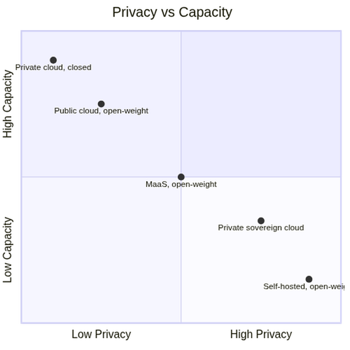
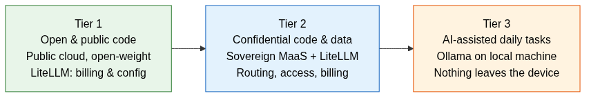
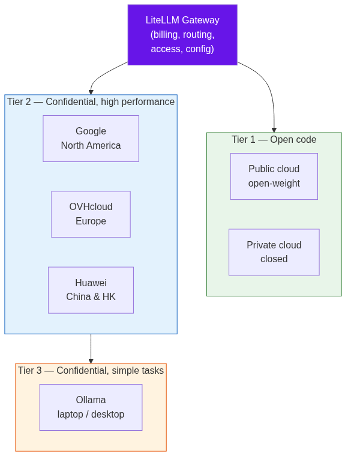
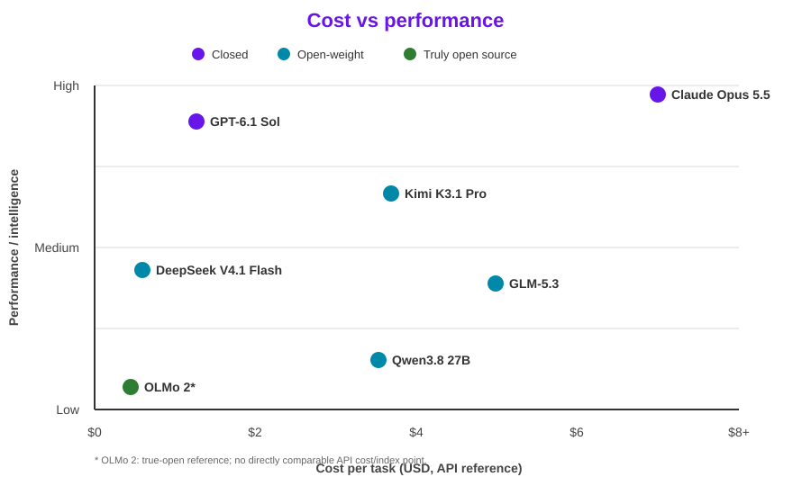

# IA Sovrana in Produzione: Modello per un Team di Sviluppo Globalmente Distribuito

Davide Ricci

Linaro Solutions & Services Group  
Vice Presidente e GM, Linaro Solutions & Services  

SFSCON 2026 - Bolzano  

---

# La domanda

È possibile sviluppare un toolkit e un'infrastruttura di IA che offra il giusto compromesso tra capacità, riservatezza e controllo?

- **→** Sotto-domanda: è possibile costruirlo indipendentemente dai grandi fornitori?
- **→** Oggi: sì — ma "indipendente" significa non essere legati a un singolo fornitore o a un singolo modello
- **→** La vera domanda: **chi può vedere i prompt e chi controlla i pesi?**

---

# Prima, allineiamoci sui termini

- **Modello chiuso**: accessibile solo attraverso il servizio del fornitore
- **Modello open-weight**: i pesi sono disponibili per il download, l'esecuzione e l'adattamento — spesso con condizioni d'uso nella licenza
- **Modello veramente open source**: rilascia anche dati e codice di addestramento (es. OLMo dell'Allen Institute for AI) — rari; la maggior parte dei modelli che chiamiamo "open" è in realtà open-weight

---
layout: two-cols
---

::title::
# Il divario si sta chiudendo

::left::
## Indice Artificial Analysis (ago 2026)

- Migliori open-weight (Kimi K3, GLM-5.3): **60**
- Migliore closed: **63**
- Costo per task: open-weight è una frazione del closed

## Attenzione
- La provenienza dei modelli open-weight è attualmente sbilanciata verso la Cina
- L'Europa deve colmare il divario; il Nord America sembra poco interessato vista la presenza dei grandi player closed-model
- Alcune licenze pongono condizioni — è già un tema di sovranità

::right::
## Costo per task

- Open-weight: ~$0.68
- Closed (flagship): ~$2.34

---

# Cinque alternative, in ordine decrescente di riservatezza e controllo

Criterio: chi può vedere i prompt e chi controlla i pesi.

---

# Il compromesso: capacità vs controllo

- **→** I modelli più grandi girano nel cloud; in self-hosting si usano modelli più piccoli
- **→** Si scambia capacità con controllo
- **→** Il divario con i modelli closed si è ridotto molto — open-weight è sufficiente per la quasi totalità dei casi d'uso

**MaaS** (Model as a Service): consumare modelli tramite un endpoint API senza gestire l'infrastruttura — il provider gestisce hosting, scalabilità e aggiornamenti.

---

# L'architettura di Linaro: tre tier

- **Tier 1** — Codice aperto: public cloud con open-weight, massima capacità (LiteLLM per fatturazione e config unificate)
- **Tier 2** — Codice e dati confidenziali: MaaS sovrano con gateway LiteLLM (fatturazione, routing, controllo accessi)
- **Tier 3** — Task quotidiani assistiti dall'IA: Ollama in locale, nulla esce dalla macchina

---
layout: two-cols
---

::title::
# Il gateway LiteLLM — piano di controllo unificato

::left::
Tutti i tier passano attraverso un unico **gateway LiteLLM** che fornisce:

- **Elenco modelli autorizzati** — quali modelli ogni team può usare
- **Controllo accessi** — permessi per utente e per progetto
- **Fatturazione unificata** — una sola fattura per tutti i tier
- **Gestione configurazione** — un unico punto per aggiornare gli endpoint

## Perché è importante
- **Previene perdite di dati** tra tier e verso account personali
- **Linee guida + setup funzionante** per evitare improvvisazioni
- **Niente vendor lock-in** — cambiare modello dietro il gateway senza modificare il codice client

::right::

---
layout: two-cols
---

::title::
# Tier 1 — Codice aperto

::left::
## Public cloud con open-weight, o private cloud con closed

- **→** Massima capacità e throughput
- **→** Nessuna preoccupazione eccessiva per la riservatezza
- **→** Il gateway LiteLLM unifica fatturazione e configurazione su tutti i tier
- **Eccezione**: le patch non ancora pubbliche e le correzioni di sicurezza sotto embargo sono trattate come confidenziali

::right::

---
layout: two-cols
---

::title::
# Tier 2 — Confidenziale, alte prestazioni

::left::
## MaaS con tre nodi sovrani

- **Google** — clienti in Nord America
- **OVHcloud** — clienti in Europa
- **Huawei** — clienti in Cina e Hong Kong

"Sovrano" = la giurisdizione del nodo coincide con quella del cliente

**Esempi OVHcloud:** Llama 3.3 70B, Mistral Small 3.2 24B, GPT-OSS 120B, Qwen3.8-27B e embedding BGE-M3. *Il catalogo è in evoluzione.*

::right::

---
layout: two-cols
---

::title::
# Tier 3 — Confidenziale, task semplici

::left::
## Ollama in locale su laptop o desktop dedicati

**Buon utilizzo:**
- Autocompletamento del codice
- Boilerplate e script helper
- Spiegazione di comandi e analisi di log
- Task semplici e autocontenuti

**Non adatto:**
- Refactoring su larga scala tra moduli
- Modifiche complesse su più file
- Generazione di progetti interi
- Task che richiedono reasoning profondo (usare Tier 1/2)

- **→** Nulla lascia la macchina
- **→** Nessun costo infrastrutturale, nessuna dipendenza dalla rete

::right::

---
layout: two-cols
---

::title::
# Prestazioni: confronto tra tier

::left::
| | Tier 3 | Tier 2 | Tier 1 |
|---|---|---|---|
| Velocità | ~12 tok/s | 38-108 tok/s | ~60 tok/s |
| Sovranità dati | On-device | Self-hosted | Cloud |
| Ideale per | Completamento, task semplici | Generazione codice, lavoro NDA | Reasoning complesso |
| Utenti concorrenti | 1 | 2-9 | Illimitati ($$) |

::right::
## Conclusione chiave

- Il Tier 3 è abbastanza veloce per **uso quotidiano** ma limitato in capacità
- Il Tier 2 offre **prestazioni di livello frontier** su dati confidenziali
- Il Tier 1 resta il migliore per **reasoning complesso e multi-step**

---

# Perché l'ibrido batte il centralizzato

1. **I dati restano nella giurisdizione** — i dati di ciascun cliente rimangono nella sua area legale
2. **Capacità e costo proporzionati alla sensibilità** — non sovra-dimensionare per task a basso rischio
3. **Il gateway rende i modelli intercambiabili** — niente vendor lock-in
4. **Accessi, budget e log in un unico punto** — controllo unificato

---

# Sovranità dei dati: tre livelli

## 1. Residenza dei dati
I dati restano entro confini geografici

## 2. Giurisdizione
Un data center in una regione ≠ fuori dalla portata di leggi extra-europee — motivo per cui per i clienti europei usiamo un provider europeo

## 3. Garanzie contrattuali e tecniche

- Nessuna conservazione dei prompt oltre quanto serve alla fatturazione
- Nessun addestramento sui dati dei clienti
- Cifratura dei dati in transito e a riposo
- Compartimentazione per cliente e per progetto
- Instradamento imposto dal gateway (il codice di un cliente europeo non può raggiungere un endpoint extra-europeo)

Verificate nei contratti e nelle certificazioni, non solo nella documentazione commerciale

---
layout: two-cols
---

::title::
# Pressioni normative e sui costi

::left::
## Pressione normativa

L'EU AI Act si applica progressivamente. La Commissione Europea lo definisce:

> «Il primo quadro giuridico completo sull'IA al mondo.»

[Commissione Europea — AI Act](https://digital-strategy.ec.europa.eu/en/policies/regulatory-framework-ai)

::right::
## Pressione su costi e controllo

The Register riporta che Revolut ha spostato l'inference di default per il coding su modelli GLM self-hosted, riducendo i costi di inference di circa il **90%**.

> «Open source is now a priority at Revolut, and our economics are favorable ... the frontier is the exception.»

David Abitbol, responsabile AI operations di Revolut, citato da [The Register, 3 novembre 2026](https://www.theregister.com/ai-and-ml/2026/11/03/british-fintech-revolut-slashes-ai-coding-costs-10x-by-cutting-out-claude-and-going-self-hosted/)

---
layout: two-cols
---

::title::
# Bilanciare costi, prestazioni e qualità

::left::
## Tre leve

1. **Selezione del modello per task** — modelli piccoli per task semplici, grandi solo dove servono
2. **Controllo della spesa via gateway** — budget per team, visibilità sui consumi
3. **Prezzo** — open-weight costa una frazione dei modelli closed di punta

Infrastruttura gestita dal provider (Tier 2 MaaS); gestiamo in proprio solo il gateway e i modelli leggeri del Tier 3.

::right::

*Snapshot illustrativo Artificial Analysis; prezzi API e costi self-hosted differiscono.*

---
layout: end
---

# Grazie + Domande

Domande benvenute

**Slide e sorgenti:** [github.com/davidinux/pub/tree/main/conferences/sfscon26](https://github.com/davidinux/pub/tree/main/conferences/sfscon26)

Copyright (c) 2026 Linaro Ltd. Licenza [CC BY 4.0](https://creativecommons.org/licenses/by/4.0/). Vedere `LICENSE`.
