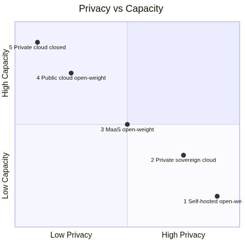
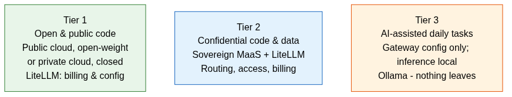
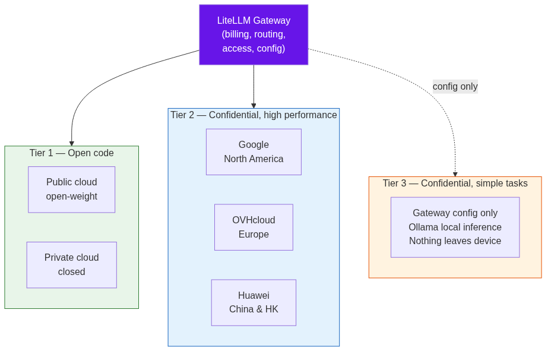
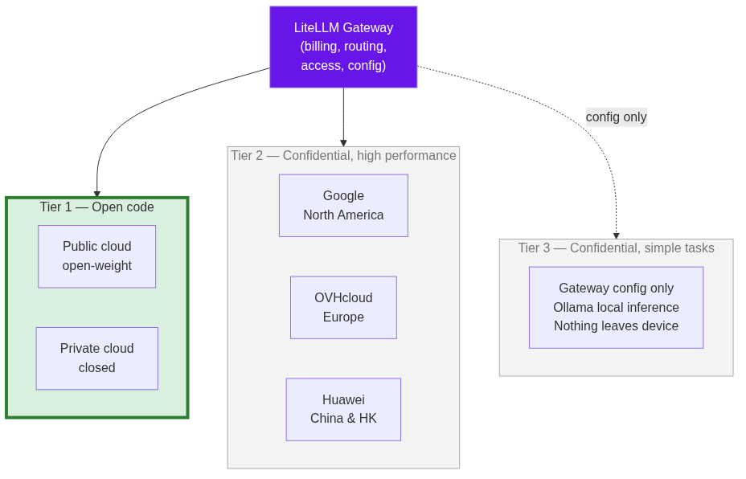
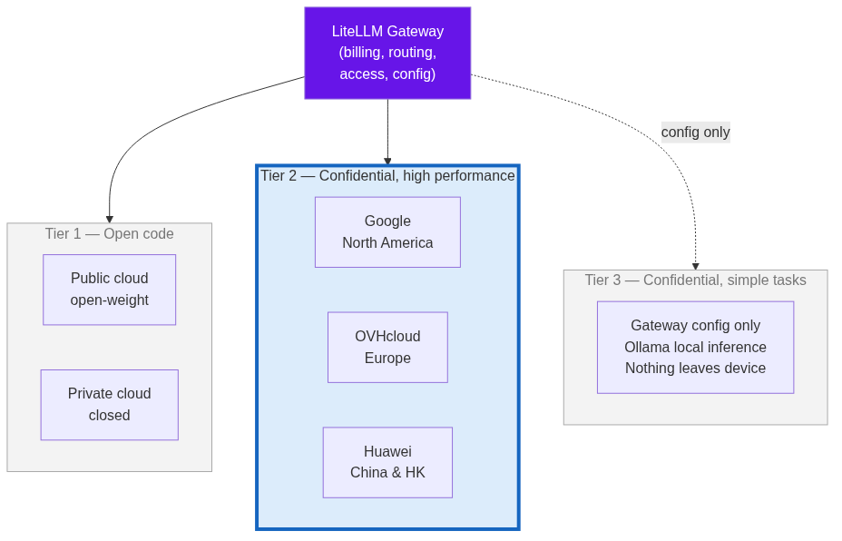
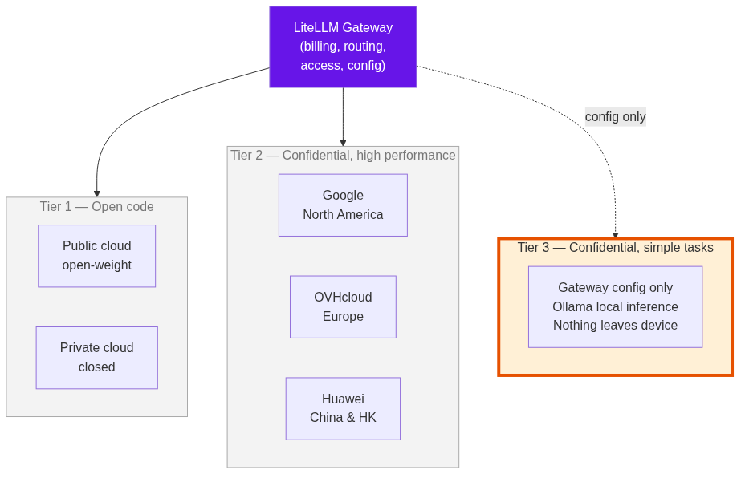
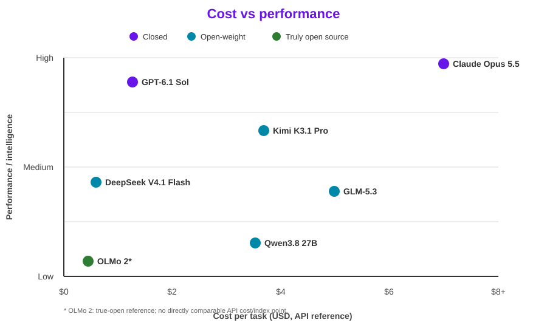

# Sovereign AI in Production: Blueprint for a Globally Distributed Dev Team

Davide Ricci

Linaro Solutions & Services Group  
VP & GM, Linaro Solutions & Services  

SFSCON 2026 - Bolzano  

---

# The Question

Can we develop an AI toolkit and infrastructure that delivers the right compromise between capacity, confidentiality, and control?

- **→** Sub-question: can we build it independent of the big providers?
- **→** Today: yes — but "independent" means not locked to a single provider or a single model
- **→** The real question: **who sees your prompts, and who controls the weights?**

---

layout: two-cols
---

::title::
# Compliance and cost pressure

::left::
## Regulatory pressure

The EU AI Act applies progressively. The European Commission says:

> “The AI Act is the first-ever comprehensive legal framework on AI worldwide.”

[European Commission — AI Act](https://digital-strategy.ec.europa.eu/en/policies/regulatory-framework-ai)

::right::
## Cost and control pressure

The Register reports that Revolut moved default coding inference to self-hosted GLM models and cut inference costs by roughly **90%**.

> “Open source is now a priority at Revolut, and our economics are favorable ... the frontier is the exception.”

David Abitbol, Revolut AI operations lead, quoted by [The Register, 3 Nov 2026](https://www.theregister.com/ai-and-ml/2026/11/03/british-fintech-revolut-slashes-ai-coding-costs-10x-by-cutting-out-claude-and-going-self-hosted/)

---

# First, let's align on terms

- **Closed model**: accessible only through the provider's service
- **Open-weight model**: weights available to download, run, and adapt — often with usage conditions in the license
- **Truly open source model**: also releases training data and code (e.g., OLMo by Allen Institute for AI) — rare; most "open" models are in fact open-weight
- **MaaS (Model as a Service)**: consume models through an API without managing hosting, scaling, or updates

---
layout: two-cols
---

::title::
# The gap is closing

::left::
## Artificial Analysis Index v4.1 (Aug 2026)

- Best open-weight (Kimi K3, GLM-5.3): **60**
- Best closed: **63**
- Cost comparison: open-weight models are roughly **1.5–3.5x cheaper** in this snapshot

## Caveat
- Open-weight model provenance is currently unbalanced toward China
- US open-weight efforts (Llama, gpt-oss, Gemma, Nemotron, OLMo) trail the Chinese labs at the top end
- Some licenses impose conditions — itself a sovereignty issue

::right::
## Cost range

- Open-weight examples: **Kimi K3, GLM-5.3**
- Closed examples: **frontier Claude/GPT models**
- Open-weight: roughly **1.5–3.5x cheaper**

---

# Five alternatives, decreasing privacy and control

Criterion: who can see the prompts, who controls the weights.

**Empty top-right:** maximum privacy and maximum capacity requires the most capital and operational complexity.

*Axes are qualitative; positions are relative, not a benchmark scale.*

---

# The tradeoff: capacity vs control

- **→** Bigger models run in the cloud; self-hosting uses smaller models
- **→** You exchange capacity for control
- **→** The gap with closed models has shrunk dramatically — open-weight is sufficient for the vast majority of use cases

---

# Linaro's architecture: three tiers

- **Tier 1** — Open code: public cloud with open-weight or private cloud with closed models, maximum capacity (LiteLLM for unified billing & config)
- **Tier 2** — Confidential code & data: sovereign MaaS with LiteLLM gateway (billing, routing, access control)
- **Tier 3** — AI-assisted daily tasks: Ollama on local machine, nothing leaves

---
layout: two-cols
---

::title::
# The LiteLLM Gateway — unified control plane

::left::
All tiers route through a single **LiteLLM gateway** that provides:

- **Authorized model list** — which models each team can use
- **Access control** — per-user, per-project permissions
- **Unified spend tracking** — one view across providers and tiers
- **Configuration management** — one place to update endpoints

## Why it matters
- **Reduces data leaks** with network egress controls
- **Guidelines + working setup** so engineers don't improvise
- **No vendor lock-in** — swap models behind the gateway without changing client code

::right::

---
layout: two-cols
---

::title::
# Tier 1 — Open code

::left::
## Public cloud with open-weight, or private cloud with closed

- **→** Maximum capacity and throughput
- **→** No excessive concern about confidentiality
- **→** LiteLLM gateway unifies billing and configuration across tiers
- **Exception**: un-published patches and security fixes under embargo are treated as confidential

::right::

---
layout: two-cols
---

::title::
# Tier 2 — Confidential, high performance

::left::
## MaaS with three sovereign nodes

- **Google** — North America clients
- **OVHcloud** — European clients
- **Huawei** — China and Hong Kong clients

"Sovereign" = node jurisdiction matches client jurisdiction

**Provider examples:** OVHcloud: Llama 3.3 70B, Mistral Small 3.2 24B, `gpt-oss-120b`, Qwen3.8-27B; Google: Gemini family; Huawei: Pangu family. *Catalog evolves.*

::right::

---
layout: two-cols
---

::title::
# Tier 3 — Confidential, simple tasks

::left::
## Ollama locally on dedicated laptops/desktops

Configured via the gateway; inference stays local and outside the gateway.

**Good fit:**
- Code completion/autocompletion
- Boilerplate and helper scripts
- Command explanations and log analysis
- Simple, self-contained tasks

**Not a good fit:**
- Large-scale refactoring across modules
- Complex multi-file changes
- Full project generation
- Tasks requiring deep reasoning (use Tier 1/2)

- **→** Nothing leaves the machine
- **→** No per-token cost, no network dependency

::right::

---
layout: two-cols
---

::title::
# Performance: tiers compared

::left::
| | Tier 1 | Tier 2 | Tier 3 |
|---|---|---|---|
| Speed | ~60 tok/s | 38-108 tok/s | ~12 tok/s |
| Data sovereignty | Cloud | Sovereign MaaS | On-device |
| Best for | Complex reasoning | Code gen, confidential work | Completion, simple tasks |
| Concurrent users | Scales with spend | 2-9* | 1 |

*2–9 concurrent Tier 2 users depends on model, context size, and node capacity.*

*Measurements: Claude Sonnet (Tier 1), Qwen3-Coder-Next/Kimi-Dev-72B (Tier 2), and a local developer machine (Tier 3); Tier 2 measured on a two-RTX-5090 node, 10–13 May 2026, using OpenCode, vLLM, and LiteLLM.*

::right::
## Key takeaway

- Tier 3 is fast enough for **daily utility** but limited in capability
- Tier 2 gives **near-frontier open-weight performance** on confidential data
- Tier 1 remains best for the **highest-end, complex multi-step reasoning**

---

# Why hybrid

1. **Data stays in jurisdiction** — each client's data remains in their legal area
2. **Capacity and cost proportional to sensitivity** — don't over-provision for low-risk tasks
3. **Gateway makes models interchangeable** — no vendor lock-in
4. **Access, budget, and logs in one point** — unified control

---

# Data sovereignty: three levels

## 1. Data residency
Data stays within geographic boundaries

## 2. Jurisdiction
A data center in a region ≠ outside extra-European laws — reason we use European providers for European clients

## 3. Contractual and technical guarantees

- No prompt retention beyond billing needs
- No training on client data
- Encryption in transit and at rest
- Compartmentation per client and per project
- Gateway-enforced routing (European client code cannot reach non-European endpoints)

Verified in contracts and certifications, not just commercial documentation

---
layout: two-cols
---

::title::
# Balancing cost, performance, quality

::left::
## Three levers

1. **Model selection by task** — small models for simple tasks, large ones only where needed
2. **Spend control via gateway** — budget per team, visibility into consumption
3. **Price** — open-weight costs a fraction of closed flagship models

Infrastructure managed by the provider (Tier 2 MaaS); we self-manage only the gateway and lightweight Tier 3 models.

::right::

*Illustrative Artificial Analysis snapshot; API pricing and self-hosting costs differ.*

---
layout: end
---

# Thank You + Q&A

Questions welcome

**Slides and source:** [github.com/davidinux/pub/tree/main/conferences/sfscon26](https://github.com/davidinux/pub/tree/main/conferences/sfscon26)

Copyright (c) 2026 Linaro Ltd. Licensed under [CC BY 4.0](https://creativecommons.org/licenses/by/4.0/). See `LICENSE`.
